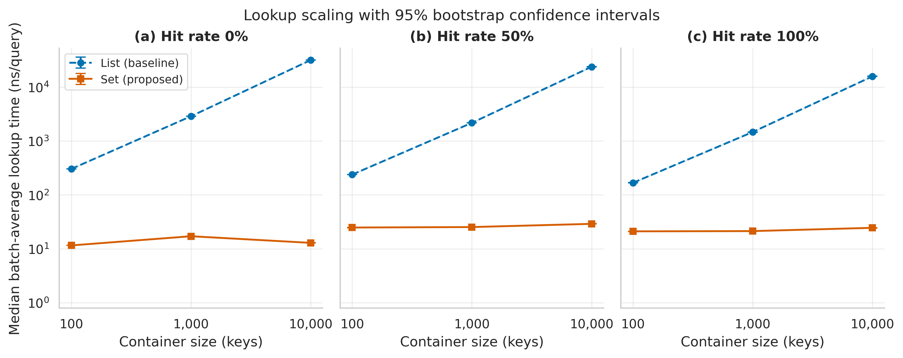
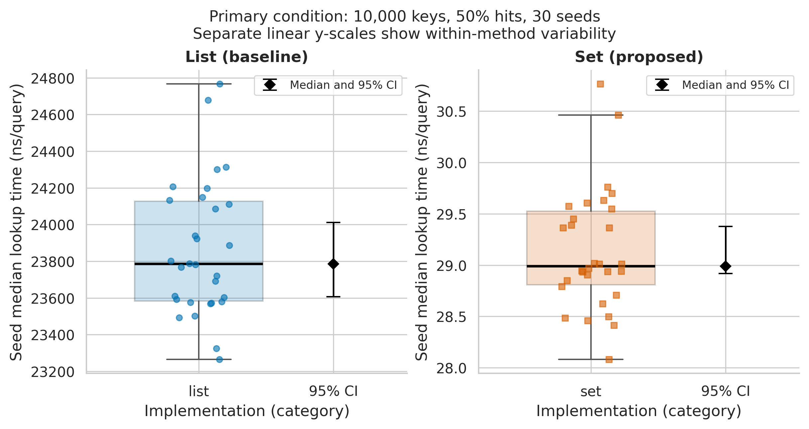

# List versus set membership for repeated integer lookup

Research Methods Task 3: real measurements, reproducible analysis and scientific visualization.

**Authors:** Кожахмет Медетбек and Джазбаев Айбар. **Track:** Software Engineering. **Release:** `v3.0.1-task3`.

This extends [Task 2](README_TASK2.md) using the same research question and study configuration. It compares built-in Python list membership (baseline) with set membership (proposed implementation) for repeated integer lookups. The Task 2 topic is continued here; no claim about an unprovided Task 1 is made.

## Results & Discussion

At the prespecified primary condition (10,000 keys, 50% hits), median paired speedup was **822.78x** (95% seed-bootstrap CI **812.66-829.02x**). The median relative reduction was **99.878%**. All 30 seed estimates exceeded the 20% threshold; the one-sided exact sign test gave **p = 9.31e-10**. Both correctness and traced-allocation guardrails passed. These results support H1 within this host and workload protocol, with the single-run limitations below.

The table gives **median (p25-p75)** across 30 seed estimates per condition. Each seed estimate aggregates eight technical repeats. Times are ns/query and include the Python loop; set/list construction is timed separately. Bold marks lower lookup time, not overall superiority on all costs.

| Keys | Hits | List median (p25-p75), ns/query | Set median (p25-p75), ns/query | Paired speedup median, x |
|---:|---:|---:|---:|---:|
| 100 | 0% | 302.65 (302.25-303.35) | **11.54 (11.52-11.56)** | 26.24 |
| 100 | 50% | 237.74 (236.18-239.75) | **24.77 (24.58-24.96)** | 9.58 |
| 100 | 100% | 167.37 (165.42-168.95) | **21.05 (20.90-21.11)** | 8.00 |
| 1,000 | 0% | 2,874.26 (2,870.62-2,879.66) | **17.07 (16.95-17.19)** | 168.59 |
| 1,000 | 50% | 2,166.77 (2,154.86-2,179.83) | **25.27 (25.14-25.60)** | 85.77 |
| 1,000 | 100% | 1,465.21 (1,436.06-1,476.12) | **21.28 (21.08-21.45)** | 68.44 |
| 10,000 | 0% | 31,708.97 (31,614.36-31,810.41) | **12.87 (12.79-13.02)** | 2,456.65 |
| 10,000 | 50% | 23,784.66 (23,582.64-24,127.62) | **28.99 (28.81-29.52)** | 822.78 |
| 10,000 | 100% | 15,768.29 (15,633.58-15,982.92) | **24.47 (24.04-24.71)** | 642.62 |


The primary-condition maximum traced allocation peaks were 0.0848 MiB for list and 0.6253 MiB for set. The full experiment had zero failed evaluation observations. Set construction took a median 101.96 microseconds versus 14.89 for list. See the [full report](reports/task3_report.md) and [English PDF report](reports/Task3_Report_EN.pdf).



Figure 1. Median of 30 seed medians of batch-average lookup time versus container size, separately for 0%, 50% and 100% hits. Each seed estimate aggregates eight evaluation repeats. Error bars and shaded bands show 95% percentile-bootstrap confidence intervals from 10,000 seed resamples. Both axes are logarithmic; intervals may be narrower than the markers. Blue dashed circles identify list; orange solid squares identify set. List time grows strongly with key count, whereas set time changes much less across these conditions.



Figure 2. Distribution of the 30 seed estimates at 10,000 keys and 50% hits. Boxes span p25-p75, the central line is the median, whiskers extend to observations within 1.5 IQR, and all seed values are plotted individually. The black diamond and caps show the median and 95% bootstrap CI. The panels use separate linear y-scales to expose within-method variation; compare absolute magnitudes with Figure 1 or the table.

## Domain model

The [C4 component diagram](docs/domain_model.md) explicitly marks construction timing (M1), lookup timing (M2), and the untimed allocation/correctness probe (M3). It includes metric definitions, equations, boundaries and invariants. File I/O is outside the measured region.

## Reproduce the analysis

Use CPython **3.12.14** for the reference environment. From the repository root:

```bash
python -m venv .venv
source .venv/bin/activate
python -m pip install -r requirements-analysis.txt
python -m unittest discover -s tests -v
python src/run_notebook.py
```

On Windows, activate with `.venv\Scripts\activate` instead. The benchmark itself remains standard-library-only; analysis has the pinned packages in `requirements-analysis.txt`. Exact versions of the analysis preparation environment are recorded in `data/provenance/analysis_packages.json`.

The final command starts a fresh kernel, executes all eight code cells in order and retains visible tables and figures in `notebooks/01_data_analysis.ipynb`. The committed notebook is already executed. Reanalysis reads the recorded JSONL, excludes warmup, retains flagged observations and failures, and regenerates deterministic CSV summaries plus vector PDF and 300 DPI PNG plots. Reanalysis does not collect new timings. Alternatively run `python src/process_data.py` and `python src/visualize.py` separately.

## Collect a separate new experiment

```bash
python src/benchmark.py --config configs/study.json --output results/new-study
```

Use a new empty output directory. This writes evaluation-only `raw.csv` for Task 2 compatibility and `raw.jsonl` with both phases. Keep its configuration, environment, schedule and status together. Do not mix runs or overwrite the submitted evidence. A new runtime that differs from `.python-version` disables primary inference. The executed study used 270 fresh worker processes, two warmup pairs and eight evaluation pairs; all timing and ground-truth checks are inherited from Task 2.

## Evidence and repository layout

```text
data/raw/test_run.jsonl             5,400 actual phase-labelled observations, about 2 MiB
data/provenance/                    configuration, run status, schedule, environment and hashes
data/processed/                    four seed/condition CSV tables and analysis audit
notebooks/01_data_analysis.ipynb     fully executed analysis, eight code cells
src/benchmark.py                   measurement instrument, including warmup logging
src/process_data.py                validation, filtering, statistics and paired bootstrap
src/visualize.py                   scientific figures in PDF and 300 DPI PNG
src/run_notebook.py                 fresh-kernel notebook execution
reports/task3_report.md             report for LMS or GitHub reading
reports/Task3_Report_EN.pdf          English report for submission
reports/figures/                    two scientific figures, each PDF and PNG
docs/domain_model.md               C4 model, equations and metric collection points
docs/task3-checklist.md             assignment criteria and verification evidence
```

The raw file is intentionally small and complete for this experiment, allowing exact reanalysis. `.gitignore` permits only the named evidence and summary files while ignoring additional raw runs, caches, environments and temporary files. The raw file SHA256 is `577b240fbee8cd3100be0c800c5142fb3772ed64df06a6ab2c69d173ae0db069`.

## Statistical scope and limitations

The experiment concerns repeated lookups in prebuilt containers. Set construction is more expensive and the set uses more traced allocations; a one-off lookup may not benefit. The data are synthetic integer workloads with uniform hit/miss sampling and no deliberate hash collisions. Results cannot be extended directly to strings, databases or production services.

Thirty seeds are workload units, not 30 computers. Eight repeated batches are technical repeats. Confidence intervals quantify seed variation conditional on one machine and collection run; they omit between-machine and between-run uncertainty. The desktop remained in use, and CPU affinity, background processes, power, temperature and frequency were not controlled. The fixed randomized schedule reduces systematic order effects but does not remove environmental noise or prove independence across runs.

Only the primary condition is used for the confirmatory sign test, under its conditional independence assumption. The other eight conditions are exploratory. We do not claim a universal Python speedup or a new algorithm; the proposed implementation is Python's built-in set.

The timing scale follows the measurements, not service RPS. Bootstrap seed is 42 and 10,000 resamples are used. The 212 IQR flags were retained. The p95/p99 fields describe the distribution of seed medians, not individual-request tail latency. M3 measurements are collected once per method/worker and copied into observation rows; they are not independent memory repeats. No cold-start improvement is claimed.

## Submission and attribution

Submit [this public repository version](https://github.com/Medetkb/integer-membership-benchmark/tree/v3.0.1-task3) and `reports/Task3_Report_EN.pdf` (or `reports/task3_report.md`) in LMS. The course brief and handouts are not redistributed. The source remains under the [MIT License](LICENSE). [CONTRIBUTIONS.md](CONTRIBUTIONS.md) preserves the pair's prior contribution record; new individual work is not invented. Task 3 code, analysis and report preparation were assisted by Codex. Both authors should understand and review the results before submission.

## References

- [Original methodology passport](docs/methodology-passport.md).
- [Python timing API](https://docs.python.org/3.12/library/time.html#time.perf_counter_ns).
- [NumPy reproducible bootstrap draws](https://numpy.org/doc/stable/reference/random/generated/numpy.random.Generator.choice.html).
- [C4 component model](https://c4model.com/diagrams/component).
- [NBClient executed notebooks](https://nbclient.readthedocs.io/en/latest/client.html).
