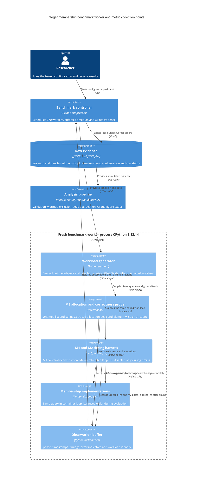

# Domain model for integer membership experiments

This Software Engineering study compares two exact membership implementations in a controlled local Python program. The C4 component diagram below expands one benchmark worker container. A fresh worker runs each combination of key count, hit rate and seed. The controller and analysis process are outside that worker boundary.

## Metric semantics

| Point | Recorded quantity | Unit | Boundary and interpretation |
|---|---|---|---|
| M1 | `build_ns` | ns/container | Creation of a new list or set; excluded from M2. |
| M2 | `batch_elapsed_ns` | ns/batch | Python membership loop and hit accumulation; 10,000 lookups per observation. |
| M2 derived | `mean_lookup_ns` | ns/query | M2 divided by 10,000; a batch-average time, not individual request latency. |
| M2 derived | `throughput_ops_per_s` | queries/s | Reciprocal transformation of the same M2 timer; not an independent endpoint. |
| M3 | `peak_python_bytes` | bytes | Separate untimed traced peak for the container and Boolean vector; not RSS. |
| Correctness | `errors` | indicator/count | Batch hit-count mismatch indicator plus mismatches in the separate element-wise check. Use failed-observation rate, not a per-query error probability. |

The M3 pass occurs before warmup and therefore allocates and accesses the data before the first recorded warmup. Warmup rows describe the configured pre-evaluation phase; they are not an untouched process cold-start measurement. Memory and element-wise checks occur once per method and worker, then are copied into its observation rows. They are not independent repeated memory measurements.

## Domain entities and invariants

A **condition** is a key count and hit rate. A **seeded workload** is the condition plus a seed and one hash of keys, queries and ground truth. A **paired repetition** evaluates both methods on that workload; method order is balanced across the eight evaluation pairs. An **observation** has one phase, method and pair number. A **seed estimate** is the median of that method's eight batch-average times. Statistical resampling uses the 30 seed estimates in a condition.

Both methods must use identical workload hashes. Warmup records never enter performance summaries. Evaluation records with errors and timing outliers remain in the dataset; guardrail failure invalidates a practical superiority claim. Failed or timed-out worker runs are incomplete studies and cannot silently enter inference. The current experiment is sequential, local, and CPU-bound; it is not a service under requests-per-second load.

## Mathematical definitions

For method $m$, condition $c$, seed $s$, and evaluation repeat $r$, define:

$$L_{mcsr}=\frac{T_{mcsr}}{QB},\qquad X_{mcsr}=\frac{10^9QB}{T_{mcsr}}.$$

Here $T$ is batch elapsed time in nanoseconds, $Q=1000$ queries and $B=10$ batch loops. $L$ is ns/query and $X$ is queries/s. Construction time is excluded from both.

$$\ell_{mcs}=\operatorname{median}_{r=1}^{8}L_{mcsr},\qquad \widehat L_{mc}=\operatorname{median}_{s=101}^{130}\ell_{mcs}.$$

$$S_{cs}=\frac{\ell_{\mathrm{list},cs}}{\ell_{\mathrm{set},cs}},\qquad R_{cs}=1-\frac{\ell_{\mathrm{set},cs}}{\ell_{\mathrm{list},cs}}.$$

We report median paired speedup $\operatorname{median}_s S_{cs}$, not the ratio of two separately pooled medians. Each percentile bootstrap draws 30 seed estimates with replacement, repeats this 10,000 times, and takes the 2.5th and 97.5th percentiles of the bootstrap median. Paired metrics are resampled as paired seed estimates. The seed for bootstrap and figure jitter is 42. Intervals describe workload-seed variation conditional on this host and run, not uncertainty across machines.

The prespecified primary condition is 10,000 keys and 50% hits. Under $H_0:\operatorname{median}(R_{cs})\leq0.20$, the one-sided exact sign test uses:

$$k=\sum_s\mathbf{1}\{R_{cs}>0.20\},\qquad p=\sum_{j=k}^{30}\binom{30}{j}2^{-30}.$$

Ties count as failures. The significance threshold is 0.05; all other conditions are exploratory. Practical support additionally requires zero correctness errors and traced allocation peaks at most 8 MiB.

## References

- [C4 component diagram scope and elements](https://c4model.com/diagrams/component).
- [Mermaid C4 notation](https://mermaid.js.org/syntax/c4.html).
- [Python 3.12 timing API](https://docs.python.org/3.12/library/time.html#time.perf_counter_ns).
- [Task 2 methodology passport](methodology-passport.md).
