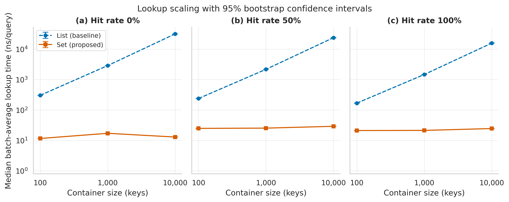
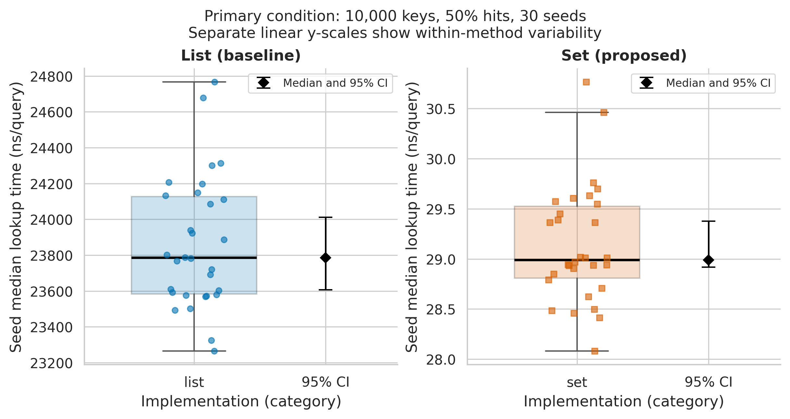

# Task 3 results of integer membership experiments

**Authors:** Кожахмет Медетбек and Джазбаев Айбар. **Collection date:** 5 November 2026. **Track:** Software Engineering.

Public repository: https://github.com/Medetkb/integer-membership-benchmark

## Research question and conclusion

Does replacing a prebuilt list with a prebuilt set reduce typical per-query time by more than 20% for 10,000 unique integers and 50% hits, while preserving correctness and staying within 8 MiB of traced allocations?

At the prespecified primary condition (10,000 keys, 50% hits), median paired speedup was **822.78x** (95% seed-bootstrap CI **812.66-829.02x**). The median relative reduction was **99.878%**. All 30 seed estimates exceeded the 20% threshold; the one-sided exact sign test gave **p = 9.31e-10**. Both correctness and traced-allocation guardrails passed. These results support H1 within this host and workload protocol, with the single-run limitations below.

## Data collection and analysis

We collected new measurements on 5 November 2026 on an Apple M3 Mac with 8 GiB RAM, native macOS and CPython 3.12.14, matching the Task 2 reference interpreter. The Task 2 study configuration was unchanged: 100, 1,000 and 10,000 keys crossed with 0%, 50% and 100% hits, seeds 101-130, 1,000 queries replayed ten times per observation, two warmup pairs and eight evaluation pairs. Each condition/seed ran in a fresh process. Both methods received the same labelled workload; evaluation order was balanced and shuffled. The new logging records phase and timestamps, including actual warmup timings, outside the timed region.

The run produced 5,400 JSONL rows: 1,080 warmup and 4,320 evaluation observations from 270 workers. Collection completed in 253.7 seconds. All warmup rows were excluded before performance summaries. IQR detection flagged 212 evaluation observations; every one was retained. Failed observations are counted as a guardrail rather than silently removed.

Latency is batch elapsed time divided by 10,000 lookups, including loop and hit-accumulation overhead. Container construction and logging are outside this timer. The allocation and element-wise correctness probe is a separate untimed pass before warmup; it is not process RSS or an independent measurement repeated eight times. The recorded warmup phase is therefore not an untouched cold start.

For each method, eight technical repeats are reduced to one seed median. Summary statistics and bootstrap intervals use the 30 seed estimates. We calculate mean, sample SD, median, p25, p75, p95 and p99; the last two are percentiles of seed medians, not individual-query tail latency. The percentile bootstrap uses 10,000 resamples and seed 42. Paired speedups and reductions are computed within seed before resampling. Throughput is derived from the same timer and is not an independent endpoint.

## Results and discussion

The table reports median (p25-p75) across the 30 seed estimates for each implementation. Lower lookup time is better. Paired speedup is the median of within-seed list/set ratios and need not equal the ratio of the two marginal medians.

| Keys | Hits | List median (p25-p75), ns/query | Set median (p25-p75), ns/query | Paired speedup median, x |
|---:|---:|---:|---:|---:|
| 100 | 0% | 302.65 (302.25-303.35) | **11.54 (11.52-11.56)** | 26.24 |
| 100 | 50% | 237.74 (236.18-239.75) | **24.77 (24.58-24.96)** | 9.58 |
| 100 | 100% | 167.37 (165.42-168.95) | **21.05 (20.90-21.11)** | 8.00 |
| 1,000 | 0% | 2,874.26 (2,870.62-2,879.66) | **17.07 (16.95-17.19)** | 168.59 |
| 1,000 | 50% | 2,166.77 (2,154.86-2,179.83) | **25.27 (25.14-25.60)** | 85.77 |
| 1,000 | 100% | 1,465.21 (1,436.06-1,476.12) | **21.28 (21.08-21.45)** | 68.44 |
| 10,000 | 0% | 31,708.97 (31,614.36-31,810.41) | **12.87 (12.79-13.02)** | 2,456.65 |
| 10,000 | 50% | 23,784.66 (23,582.64-24,127.62) | **28.99 (28.81-29.52)** | 822.78 |
| 10,000 | 100% | 15,768.29 (15,633.58-15,982.92) | **24.47 (24.04-24.71)** | 642.62 |

Primary-condition list time was 23,784.66 ns/query (95% CI 23,606.32-24,011.85); set time was 28.99 ns/query (95% CI 28.92-29.38). Median throughput was 42,044 and 34,495,244 queries/s, respectively.

Median construction time across seed medians was 14.89 microseconds for list and 101.96 microseconds for set. Maximum traced allocation peaks in this condition were 0.0848 and 0.6253 MiB. There were 0/4,320 failed evaluation observations and 0/1,080 failed warmup observations; the maximum traced peak across the full grid was 0.6253 MiB against an 8 MiB limit. The observed zero rate does not prove an error probability of zero outside these tests.

Figure 1. Median of 30 seed medians of batch-average lookup time versus container size, separately for 0%, 50% and 100% hits. Each seed estimate aggregates eight evaluation repeats. Error bars and shaded bands show 95% percentile-bootstrap confidence intervals from 10,000 seed resamples. Both axes are logarithmic; intervals may be narrower than the markers. Blue dashed circles identify list; orange solid squares identify set. List time grows strongly with key count, whereas set time changes much less across these conditions.

Figure 2. Distribution of the 30 seed estimates at 10,000 keys and 50% hits. Boxes span p25-p75, the central line is the median, whiskers extend to observations within 1.5 IQR, and all seed values are plotted individually. The black diamond and caps show the median and 95% bootstrap CI. The panels use separate linear y-scales to expose within-method variation; compare absolute magnitudes with Figure 1 or the table.

## Domain model

The [C4 component diagram and formal metric definitions](../docs/domain_model.md) expand the fresh benchmark worker. M1 measures construction, M2 measures the membership loop, and M3 measures untimed traced allocations and correctness. Workload generation, buffering, controller file I/O and the analysis pipeline are outside M2.

## Limitations

The experiment concerns repeated lookups in prebuilt containers. Set construction is more expensive and the set uses more traced allocations; a one-off lookup may not benefit. The data are synthetic integer workloads with uniform hit/miss sampling and no deliberate hash collisions. Results cannot be extended directly to strings, databases or production services.

Thirty seeds are workload units, not 30 computers. Eight repeated batches are technical repeats. Confidence intervals quantify seed variation conditional on one machine and collection run; they omit between-machine and between-run uncertainty. The desktop remained in use, and CPU affinity, background processes, power, temperature and frequency were not controlled. The fixed randomized schedule reduces systematic order effects but does not remove environmental noise or prove independence across runs.

Only the primary condition is used for the confirmatory sign test, under its conditional independence assumption. The other eight conditions are exploratory. We do not claim a universal Python speedup or a new algorithm; the proposed implementation is Python's built-in set.

## Reproduction and evidence

From the repository root, install `requirements-analysis.txt` with Python 3.12.14, then run `python src/run_notebook.py`. This launches a fresh kernel and saves outputs into [the notebook](../notebooks/01_data_analysis.ipynb), regenerates [processed CSV tables](../data/processed/metrics_summary.csv), and exports both figures as vector PDF and 300 DPI PNG. Reanalysis does not rerun the experiment. See the root README for a separate new-measurement command.

Raw data SHA256: `577b240fbee8cd3100be0c800c5142fb3772ed64df06a6ab2c69d173ae0db069`. Exact collection configuration, schedule, status, environment and source hashes are in `data/provenance/`. The benchmark source hash in `environment.json` identifies the measurement instrument used. Bootstrap seed is 42; resamples are 10,000.

## Technical references

1. [Python 3.12 timing API](https://docs.python.org/3.12/library/time.html#time.perf_counter_ns), for the timer used by the measurement instrument.
2. [NumPy random sampling with replacement](https://numpy.org/doc/stable/reference/random/generated/numpy.random.Generator.choice.html), for reproducible seed-level bootstrap draws.
3. [C4 component diagram](https://c4model.com/diagrams/component), for the architectural model.
4. [NBClient notebook execution](https://nbclient.readthedocs.io/en/latest/client.html), for fresh-kernel execution and retained outputs.
